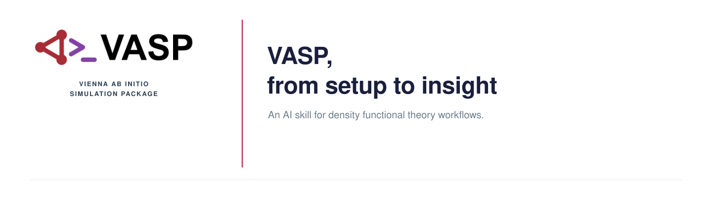

<p align="center">
  
</p>

A Claude AI skill for setting up, running, debugging, and interpreting VASP
density functional theory calculations. Covers VASP 4.4-4.6 with modern
VASP 5/6 annotations, including meta-GGA, van der Waals, phonons, GW,
optical properties, and machine-learned force fields.

## About

I work with VASP for DFT calculations on materials — bulk relaxations,
surface slabs, magnetic oxides, band structures, phonon dispersions,
hybrid functionals — and the same setup questions come up every project:
which ISMEAR for this system, how to set MAGMOM for antiferromagnetic
ordering, what ISIF controls what, why the electronic loop won't converge,
how to pick the right POTCAR variant. This skill teaches Claude all of
that so it can write correct INCAR files, explain what a tag does, and
catch the mistakes that waste compute hours.

The skill was distilled from "VASP the GUIDE" (156-page official PDF,
August 2005) and the official VASP wiki into 29 topic-organized sections,
cross-referenced for modern features. It preserves version-specific
defaults and flags where VASP 4.x and VASP 5/6 differ.

## Contents

| Section | Topic | What it covers |
|---|---|---|
| 1 | Input Files Overview | Four required files, INCAR syntax |
| 2 | POSCAR Format | Lattice, positions, selective dynamics, velocities |
| 3 | KPOINTS Formats | Automatic mesh, explicit, line-mode for bands |
| 4 | POTCAR Guidelines | PAW vs. US-PP, variants by element group, licensing |
| 5 | Precision and Cutoff | PREC, ENCUT, ENAUG with version notes |
| 6 | Electronic Minimization | ALGO, EDIFF, NELM, mixing for difficult convergence |
| 7 | Ionic Relaxation | IBRION (0-8), NSW, ISIF table, EDIFFG, POTIM |
| 8 | Smearing and k-points | ISMEAR, SIGMA, metal reference values, tetrahedron vs. MP |
| 9 | Spin Polarization | ISPIN, MAGMOM, non-collinear, spin-orbit coupling |
| 10 | Startup and Restart | ISTART, ICHARG, band structure workflow |
| 11 | DFT+U | LDAU tags, Dudarev vs. Liechtenstein, LMAXMIX, NiO example |
| 12 | Output Control | LWAVE, LCHARG, LORBIT, LVTOT, NEDOS |
| 13 | Real-Space and GGA | LREAL, GGA functionals, functional-POTCAR matching |
| 14 | Performance | NCORE, KPAR, NPAR, LPLANE, NSIM, GPU tips |
| 15 | DOS and Band Structure | Three-step workflow with INCAR examples |
| 16 | Molecular Dynamics | SMASS, thermostats, temperature correction, simulated annealing |
| 17 | Calculation Recipes | Static, relaxation, EOS, Pulay stress, magnetic, slab, defaults |
| 18 | Output Files | 14 output files with OUTCAR grep patterns |
| 19 | Errors and Troubleshooting | Convergence, wrap-around, Pulay stress, ZBRENT, RMM-DIIS |
| 20 | Convergence Testing | ENCUT and k-points protocols, recommended targets |
| 21 | Hybrid Functionals | PBE0, HSE06, NKRED, Berry phase, NEB |
| 22 | Meta-GGA Functionals | SCAN, r2SCAN, METAGGA tag, LASPH, MBJ, LIBXC |
| 23 | Van der Waals Corrections | DFT-D3, DFT-D4, nonlocal vdW-DF functionals |
| 24 | Optical Properties | LOPTICS, LEPSILON, CSHIFT, dielectric response |
| 25 | GW Calculations | G0W0 recipe, HSE+GW, ENCUTGW, LSPECTRAL |
| 26 | Phonons and Lattice Dynamics | Finite differences, DFPT, phonopy workflow |
| 27 | Surface Calculations | 5-step slab workflow, dipole correction, work function |
| 28 | POTCAR Selection Guide | Element-by-element PAW recommendations |
| 29 | Machine-Learned Force Fields | ML_LMLFF, train/refit/run workflow, VASP 6.3+ |

## How to use it

### As a Claude Code skill

Place `SKILL.md` in your project's skill directory and Claude loads it
automatically when you ask a VASP question.

```bash
mkdir -p .claude/skills/vasp
cp SKILL.md .claude/skills/vasp/SKILL.md
```

### As a Claude.ai account skill

Upload `SKILL.md` as a skill in your Claude.ai settings. It activates
whenever you ask about VASP input files, DFT parameters, convergence,
or calculation workflows.

### In a Claude Project

Copy the contents of `SKILL.md` into the project's custom instructions.

---

## What the skill does

Given a materials system — say, NiO with antiferromagnetic ordering and
Hubbard U correction — Claude will produce a complete set of INCAR
parameters with the right ISPIN, MAGMOM, LDAU tags, and LMAXMIX. It
flags which VASP version introduced each feature and warns about the
things that usually go wrong (wrong POTCAR order, ISMEAR for
semiconductors, Pulay stress in volume relaxation).

It handles the questions that come up during a project:

- "Set up a full cell relaxation for this perovskite"
- "Why won't the electronic loop converge for my slab?"
- "What ISMEAR and SIGMA should I use for this metal?"
- "Write the INCAR for a band structure calculation from my SCF CHGCAR"
- "How do I add spin-orbit coupling to my NiO DFT+U setup?"
- "My volume relaxation gives wrong lattice parameters"
- "Set up a SCAN+rVV10 calculation for a layered material"
- "How do I compute phonon dispersions with VASP and phonopy?"
- "Train a machine-learned force field for my MD simulation"
- "What POTCAR variant should I use for calcium?"

---

## Source

Generated from "VASP the GUIDE" (PDF, August 2005, covering VASP 4.4-4.6)
and the official VASP wiki at https://vasp.at/wiki/The_VASP_Manual using
Claude AI. The PDF was read section by section and condensed into a
structured reference. See [references/SOURCES.md](references/SOURCES.md)
for full attribution and version details.

VASP is proprietary software developed by Georg Kresse and Juergen
Furthmueller at the University of Vienna. A license is required to use
VASP. POTCAR files are not included and cannot be redistributed.

## License

MIT. See [LICENSE](LICENSE).
